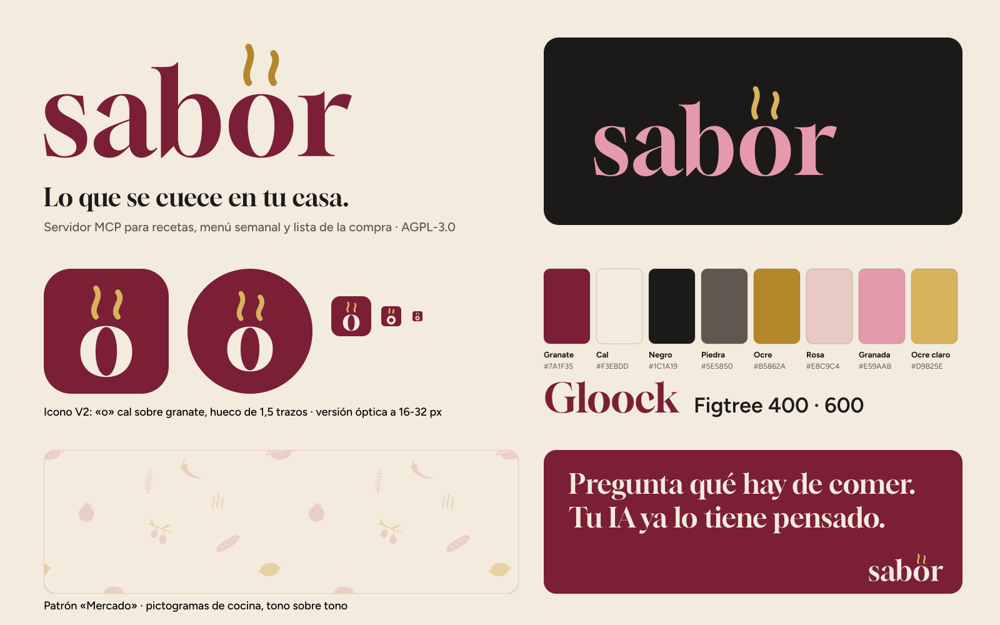
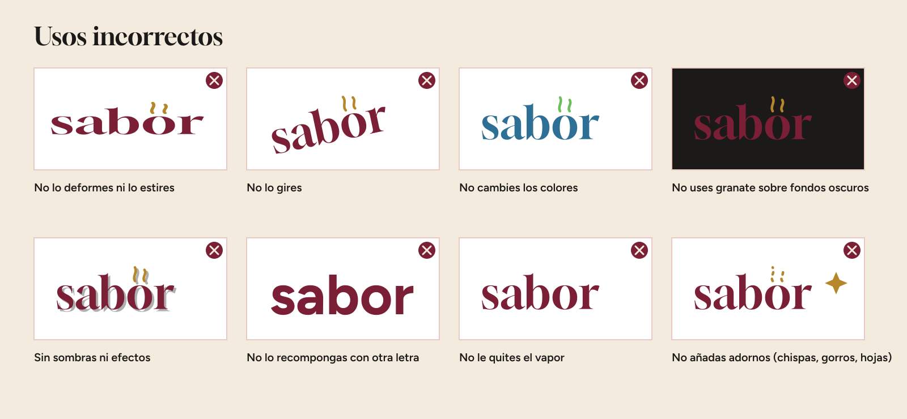

# Sabor · Manual de marca (v1.0, 27/10/2026)

## 1. Concepto
**La «o» humeante.** «sabor» en Gloock, una serif de mucho contraste con aire de recetario y de rótulo de casa de comidas. De la «o» sale vapor: algo está al fuego. La «o» es a la vez una letra, una cazuela vista desde arriba y un plato. El granate (vino, remolacha, embutido) y la cal (paredes y mantel) dan el tono. El ocre es el calor.
Promesa: recetas, menú semanal y lista de la compra, y siempre se te pregunta antes de actuar.

### Textos de marca (aprobados el 27/10/2026)
| | Texto | Uso |
|---|---|---|
| **Lema** | *Lo que se cuece en tu casa.* | Va con el logotipo como titular: cabecera del README, tarjeta social y lámina resumen. Siempre en Gloock, por encima de la frase de apoyo, que es más pequeña. Juega con «cocerse» (lo que está al fuego, como el vapor de la «o») y «lo que pasa en casa». |
| **Frase de apoyo** | *Pregunta qué hay de comer. Tu IA ya lo tiene pensado.* | Explica qué hace Sabor. Va debajo del lema en Figtree 500, más pequeña, o sola como titular en Gloock cuando el logotipo ya actúa de firma (post cuadrado, panel granate del resumen). Si no cabe en una línea, se parte entre las dos frases, nunca dentro de una. |

- Sustituyen a «Tu cocina de casa, en orden.» (lema) y «Del recetario a la lista de la compra.» (apoyo).
- Se escriben tal cual: con punto final, «IA» en mayúsculas y sin comillas en las piezas. No se traducen.
- Las plantillas y las láminas usan estos textos.

## 2. Logotipo (`logo/`)
| Archivo | Uso |
|---|---|
| `sabor-logo-color` | Principal: granate con vapor ocre, sobre cal o blanco |
| `sabor-logo-granate` | Monocromo granate (sellos, una tinta) |
| `sabor-logo-negro` | Una tinta negra, fax, prensa |
| `sabor-logo-blanco` | Invertido en cal sobre fotos o colores oscuros |
| `sabor-logo-sobre-granate` | Cal con vapor ocre claro, sobre fondo granate |
| `sabor-logo-oscuro` | Granada con vapor ocre claro, sobre negro (modo oscuro) |
| `sabor-simbolo-*` | **Versión compacta:** la «o» humeante sola, para espacios cuadrados |

Todos son SVG con el texto en trazados, más un PNG transparente de 1200 px y otro de 400 px.
- **Área de respeto:** como mínimo **x** (el alto de la «o») libre alrededor, medida desde el borde del vapor. Para el símbolo y el icono, ¼ del lado. Ver `logo/area-respeto.png`.
- **Tamaño mínimo:** logotipo de 96 px de ancho en pantalla o 25 mm impreso. Por debajo de eso, usa el símbolo o el icono.
- **Cambio respecto al B6 de la ronda 4:** el vapor pasa de rizos apretados a dos hilos en S suave de alturas distintas, algo más separados de la «o». Así no se lee como una diéresis («sabör») y comparte el dibujo con el icono. Las letras no cambian.
- **Hueco del vapor (ajuste del 27/10/2026):** `WM_GAP` pasa de 0,055 a **0,096** del cuerpo. El hueco real entre el remate de cada hilo y el contorno de la «o» bajo él pasa de ≈0,77 a **1,5 trazos**, el mismo criterio que el icono V2. Las letras no cambian; el logotipo gana un 4 % de alto por arriba. A 96 px de ancho el hueco mide ≈3 px y el vapor se lee como vapor, no como diéresis («sabör»).
- **Longitud del vapor (ajuste del 27/10/2026, opción B):** `WM_H` pasa de 0,40 a **0,30** del cuerpo, **la misma longitud que el vapor del icono**. La amplitud de la S (`WM_A`) baja de 0,07 a 0,0606 para que la curva no quede nerviosa. El tope del vapor pasa de 1,046 a 0,946 del cuerpo: **supera la ascendente de la «b» (0,788) en un 20 %**, antes un 33 %. El vapor sigue siendo el punto más alto del logotipo, pero ya no le quita protagonismo a la «b» y el conjunto queda más compacto. Se mantienen el hueco de 1,5 trazos, el grosor, los remates, la separación entre hilos y las letras. El logotipo pierde un 9 % de alto por arriba.

### Usos incorrectos

No deformar, no girar, no cambiar los colores, no poner el granate sobre fondos oscuros (usa la versión `oscuro` o `blanco`), sin sombras ni efectos, no recomponerlo con otra letra, no quitarle el vapor y no añadir adornos (chispas, gorros, hojas). Tampoco cambiar el ocre del vapor por el naranja #FF4D00 ni por colores cercanos.

## 3. Icono (`icono/`)
**Icono oficial: V2 centrada** (aprobada el 27/10/2026). Es la «o» cal sobre granate, con vapor ocre claro (alternativa B de `icono/alternativas-icono.png`).
- **Dibujo:**
  - dos hilos en S suave; el derecho mide el 86 % del izquierdo;
  - el **hueco entre el vapor y la «o» es de 1,5 trazos**, medido sobre el contorno real de la «o» bajo cada hilo;
  - en el icono de app, la «o» mide 390/512; en el circular, 342/512.
- **Centrado óptico por caja de tinta:**
  - el conjunto de «o» y vapor se centra con la tinta real renderizada, no con la caja de la letra, así que los márgenes superior e inferior son iguales (68,5 px en la app y 91,5 px en el circular, sobre 512);
  - la «o» va en el eje;
  - el vapor se desplaza un 0,69 % del cuerpo a la derecha para que su centroide caiga en el eje, porque el hilo izquierdo es más largo.
- **Formas:**
  - `icono/icono-app.svg`: cuadrado redondeado, con radio 112/512;
  - `icono/icono-circular.svg`: avatar circular;
  - `icono/icono-cuadrado-completo.svg`: a sangre, para plataformas que recortan por su cuenta (GitHub, iOS).
- **Versión óptica para 16 y 32 px** (`icono/icono-app-pequeno.svg`, `icono/icono-circular-pequeno.svg`, `icono/favicon.svg`):
  - anillo de grosor uniforme (r 18,5 y trazo 13 sobre una caja de 100) en lugar de la «o» de Gloock, que a 16 px se perdía y se leía como un «0»;
  - hilos de trazo 9 con el mismo hueco proporcional;
  - el mismo centrado por caja de tinta.
- **Archivos exportados:**
  - `icono/favicon.ico` con 16 y 32 px en la versión óptica y 48 px con la «o» completa;
  - `icono/apple-touch-icon.png` (180) y `icono/avatar-github-500.png`;
  - `icono/png/`, de 16 a 1024 px (app y circular): 16 y 32 en óptica, desde 48 la completa;
  - la variante clara `icono/png/icono-app-claro-1024.png`, para impresión o fondos muy oscuros.
- **Símbolo:** `logo/sabor-simbolo-*` y el post cuadrado usan el mismo dibujo V2, sin fondo.

## 4. Color (`color/`)
Paleta, roles y modo oscuro en `color/paleta.png`. Tokens en `color/tokens.css` (custom properties con `prefers-color-scheme`) y en `color/tokens.json`. Contraste calculado en `color/contraste.md`.

| Color | HEX | RGB | Rol en claro | Rol en oscuro |
|---|---|---|---|---|
| Granate | #7A1F35 | 122 31 53 | Marca, acento, enlaces (8,55:1 sobre cal) | — |
| Cal | #F3EBDD | 243 235 221 | Fondo | Texto |
| Negro tizón | #1C1A19 | 28 26 25 | Texto (14,65:1) | Fondo |
| Piedra | #5E5850 | 94 88 80 | Texto secundario (5,94:1) | — |
| Ocre | #B5862A | 181 134 42 | **Solo decorativo** (2,77:1 sobre cal) | — |
| Rosa polvo | #E8C9C4 | 232 201 196 | Bloques, patrón, separadores | — |
| Granada | #E59AAB | 229 154 171 | — | Marca y acento (7,88:1) |
| Ocre claro | #D9B25E | 217 178 94 | Vapor sobre granate (5,05:1) | Vapor y acento 2 (8,65:1) |
| Pizarra | #2A2624 | 42 38 36 | — | Superficies |
| Piedra clara | #B8B0A5 | 184 176 165 | — | Texto secundario (8,08:1) |

Ningún color se acerca al naranja vetado: el más próximo, el ocre, está a ΔE 58.

## 5. Tipografía (`tipografia/`)
Gloock para titulares y Figtree para texto (400, 500, 600 y 700), ambas con licencia OFL en Google Fonts. La escala y las alternativas del sistema están en `tipografia/tipografia.md` y el espécimen en `tipografia/especimen.png`.

## 6. Plantillas (`plantillas/`)
Hay cabeceras de README en claro y oscuro (1280×320, con el código `<picture>`), una tarjeta social de 1280×640 y posts de 1080×1080 y 1080×1350. Todas son SVG editables, con el copy en español. Las instrucciones están en `plantillas/README.md`.

## 7. Tono visual (`tono/`)
Formas planas y vistas de frente o desde arriba. El vapor va en S suave y la «o» hace de cazuela. En fotografía, una cocina real con luz natural, donde importa más el proceso que el emplatado. **El patrón oficial es «Mercado»:** los pictogramas sueltos y girados, con poco contraste para no competir con el logotipo. Hay dos versiones:
- claro: cal con rosa polvo y ocre muy suaves;
- oscuro: pizarra, tono sobre tono.

Está en `tono/patron-mercado-claro.svg` y `tono/patron-mercado-oscuro.svg`, de 960×600, y como tile sin costuras de 460 px en `tono/patron-mercado-claro-tile.svg` y `tono/patron-mercado-oscuro-tile.svg`. Las reglas completas están en `tono/README.md`. El patrón anterior («o» humeante) queda retirado.

## 8. Pictogramas (`pictogramas/`)
Hay 13 piezas: cazuela de barro, ajo, guindilla, granada, aceitunas, barra de pan, limón, huevo frito, cuchara de palo, tomate, alubias, romero y vapor.
- **Dibujo.** Formas llenas y planas, sin contorno, sin degradados ni sombras. El trazo tiene contraste y los remates van en gota o en cuña, como Gloock. El vapor siempre va en S suave, con remate redondo, igual que en el logotipo. Cada pieza va de frente o de perfil y en una caja de 100×100. Nada de clichés (lista en `tono/README.md`).
- **Color.** Una tinta principal y el ocre de acento:
  - sobre fondos claros, granate #7A1F35 y ocre #B5862A (el archivo lleva el nombre de la pieza, por ejemplo `pictogramas/ajo.svg`); el limón va en ocre;
  - sobre granate, pizarra o negro, cal #F3EBDD y ocre claro #D9B25E (el mismo nombre con sufijo `-cal`, por ejemplo `pictogramas/ajo-cal.svg`);
  - en patrones, tono sobre tono, como en «Mercado».
- **Tamaño mínimo: 32 px.** **El romero y las alubias no deben usarse a menos de 32 px:** a 16 px se empastan. El resto aguanta mejor en pequeño, pero 32 px es el mínimo para todo el set.
- **No hacer:** mezclar pictogramas con el icono de la app, ponerlos al lado del logotipo como si fueran parte de él, contornearlos, recolorearlos fuera de la paleta ni usarlos como sustitutos de la «o».

## 9. Fuentes de trabajo

Los generadores de estos archivos se guardan fuera del repositorio. Quien mantiene el proyecto puede facilitarlos.

## 10. Licencia

Los archivos de este directorio se publican bajo la licencia [Creative Commons Atribución-CompartirIgual 4.0 Internacional (CC BY-SA 4.0)](LICENSE.md), aparte de la AGPL-3.0 del código.
